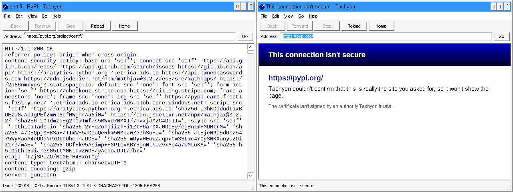

# Tachyon

**The modern web, sent back to 1995.**

Tachyon is a web browser for Windows 95 that aims to handle today's internet:
HTML5, modern JavaScript and TLS 1.3, running natively on Windows 95 with
nothing else installed. A tachyon is a hypothetical particle that travels
backwards in time.



## Status

**Sprint 1: Hello, HTTPS.** Tachyon loads pages over HTTP and HTTPS (TLS 1.2
and 1.3, checked against Mozilla's root certificates) and shows their source.
It can't draw pages yet: HTML parsing is Sprint 2 and rendering Sprint 3.

- A WHATWG URL parser that passes all 896 web-platform-tests URL cases.
- HTTP/1.1 with chunked bodies, redirects, gzip and deflate, and HTTP proxies.
- Mbed TLS 4.1 LTS with its own entropy pool, because Windows 95 has no
  reliable random number source.
- `FETCH.EXE`, the same network stack on the command line, for testing from
  an MS-DOS Prompt.

The plan, the current sprint and every decision so far are on the
[sprint board](docs/SPRINTS.md).

## Requirements

- Windows 95, any release. No extra DLLs: Tachyon uses only what a fresh
  install has (including `CRTDLL.DLL` and Winsock 1.1).
- For now, a Pentium Pro, Pentium II or newer CPU. The original Pentium is the
  goal once we build our own toolchain (see the backlog).

## Trying it

Every push builds a zip, a 1.44 MB floppy image and a CD-ROM image on
GitHub Actions: open the latest **CI** run and download the `tachyon-win95`
artifact. Windows 95 needs TCP/IP set up and the right date and time.
[Testing on Windows 95](docs/TESTING-ON-WIN95.md) explains how to get it
into a virtual machine and what to report.

## Building

You need Linux (or WSL) with CMake 3.20+, Ninja and Python 3. For the
Windows 95 build, add MinGW-w64; to run its tests, add Wine (32-bit) and
Xvfb. On Ubuntu 24.04:

```sh
sudo dpkg --add-architecture i386 && sudo apt-get update
sudo apt-get install cmake ninja-build python3 mingw-w64 wine wine32:i386 xvfb
```

```sh
# Host build: the portable core and its unit tests, natively
cmake --preset host && cmake --build --preset host && ctest --preset host

# Windows 95 build: TACHYON.EXE and FETCH.EXE, every .exe checked by win95check
cmake --preset win95 && cmake --build --preset win95
xvfb-run -a ctest --preset win95       # unit, integration and GUI smoke tests under Wine

# Package for testers: dist/*.zip, *.img (floppy), *.iso
tools/package.sh build/win95 dist
```

## How it's built

- **C99**, cross-compiled with MinGW-w64 for the Pentium (`-march=i586`),
  against the Windows 95 headers (`_WIN32_WINNT=0x0400`).
- **A portable core** (`src/core`) that never touches the OS, so it is tested
  natively on Linux, plus **a thin Win32 layer** (`src/platform/win32`).
- **`win95check`** (`tools/win95check`) reads every executable's import table
  and refuses anything Windows 95 doesn't have, and disassembles it to refuse
  instructions newer than the CPU floor.
- We write the engine (URL, HTTP, HTML, DOM, CSS, layout, painting) and borrow
  the parts nobody should write alone: Mbed TLS for TLS, zlib for
  decompression, and (from Sprint 5) QuickJS-ng for JavaScript. Third-party
  code lives in `third_party/` with notes on its version and changes.

More in [docs/ARCHITECTURE.md](docs/ARCHITECTURE.md).

## Contributing

Read [CLAUDE.md](CLAUDE.md) for the house rules (they apply to humans too),
then the [sprint board](docs/SPRINTS.md) for what's being worked on.

## License

GNU General Public License v3. See [LICENSE](LICENSE).
