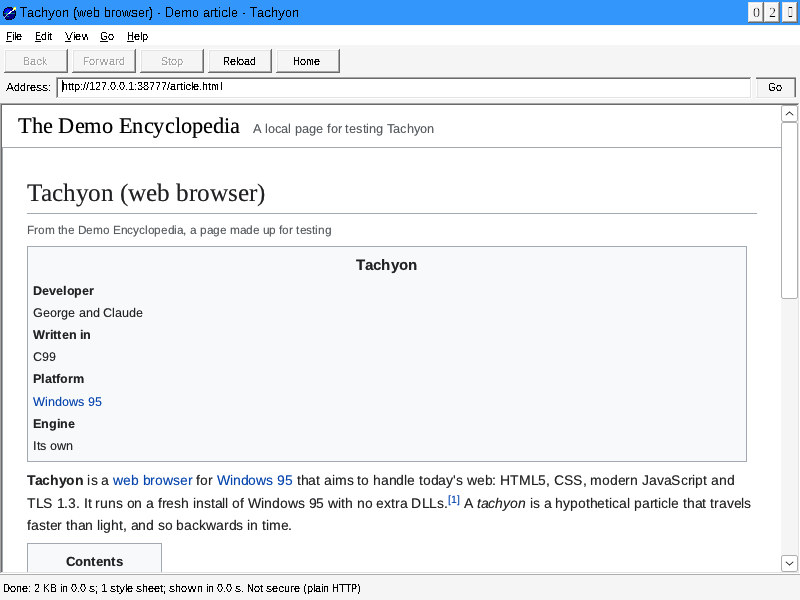

# Tachyon

**The modern web, sent back to 1995.**

Tachyon is a web browser for Windows 95 that aims to handle today's internet:
HTML5, modern JavaScript and TLS 1.3, running natively on Windows 95 with
nothing else installed. A tachyon is a hypothetical particle that travels
backwards in time.



## Status

**Sprint 3: First Light.** Tachyon draws pages. It fetches them over HTTP
and HTTPS (TLS 1.2 and 1.3), parses them the way today's browsers do, loads
their style sheets, and lays out and paints them with its own engine, in the
TrueType fonts Windows 95 already has. Links work, and the document tree and
source are a menu away. Tables, floats and positioned boxes are laid out as
plain blocks until Sprint 7, images are placeholders until Sprint 4, and
scripts don't run until Sprint 5.

- CSS written from today's specifications: the syntax (it passes
  css-parsing-tests, apart from a listed few where the tests predate the
  spec), selectors with `:is()`, `:where()` and `:not()`, matched fast
  enough for Wikipedia, the cascade with layers, nesting, custom
  properties, `var()`, `calc()` and width media queries, and the HTML
  Standard's user-agent style sheet.
- Block and inline layout: margin collapsing, line breaking, white space,
  text alignment, vertical alignment, inline blocks, lists and generated
  content; painting of backgrounds, Windows 95-style 3D borders, text and
  its decorations.
- Text rasterised by stb_truetype from Windows 95's own fonts (Arial, Times
  New Roman, Courier New and the rest), with kerning and synthetic bold and
  italic.
- Style sheets load over kept-alive connections, with a small cache.
- An HTML parser written from the October 2026 HTML Standard: it passes
  all 7,049 html5lib tokenizer cases and 3,890 of web-platform-tests' 3,898
  tree-construction cases. The parser and the renderer both survive fuzzing
  under AddressSanitizer.
- The WHATWG Encoding Standard's encodings (UTF-8, UTF-16 and every
  single-byte one) and its rules for finding a page's encoding.
- A WHATWG URL parser that passes all 896 web-platform-tests URL cases.
- HTTP/1.1 with chunked bodies, redirects, gzip and deflate, and HTTP proxies.
- Mbed TLS 4.1 LTS with its own entropy pool, because Windows 95 has no
  reliable random number source.
- `FETCH.EXE`, the same network stack, parser and renderer on the command
  line, for testing from an MS-DOS Prompt.

The plan, the current sprint and every decision so far are on the
[sprint board](docs/SPRINTS.md).

## Requirements

- Windows 95, any release. No extra DLLs: Tachyon uses only what a fresh
  install has (including `CRTDLL.DLL` and Winsock 1.1).
- For now, a Pentium Pro, Pentium II or newer CPU. The original Pentium is the
  goal once we build our own toolchain (see the backlog).

## Trying it

Download the installer for Windows 95 from
[Releases](https://github.com/georgemathieson/Windows-95-modern-browser/releases).
Every sprint publishes a test build there, with a CD-ROM image, a floppy
image and a zip. Every push also builds them on GitHub Actions: open the
latest **CI** run and download the `tachyon-win95` artifact. Windows 95
needs TCP/IP set up and the right date and time.
[Testing on Windows 95](docs/TESTING-ON-WIN95.md) explains how to get it
into a virtual machine and what to report.

## Building

You need Linux (or WSL) with CMake 3.20+, Ninja and Python 3. For the
Windows 95 build, add MinGW-w64; to run its tests, add Wine (32-bit) and
Xvfb. On Ubuntu 24.04:

```sh
sudo dpkg --add-architecture i386 && sudo apt-get update
sudo apt-get install cmake ninja-build python3 mingw-w64 wine wine32:i386 xvfb
sudo apt-get install fonts-liberation               # the reference tests' fonts
sudo apt-get install zip mtools genisoimage nsis    # for packaging
```

```sh
# Host build: the portable core and its unit tests (including the html5lib,
# web-platform-tests and css-parsing-tests suites) and reference tests, natively
cmake --preset host && cmake --build --preset host && ctest --preset host

# Render a page to PNG on the host, as the reference tests do
build/host/tools/render/tachyon-render page.html page.png

# Windows 95 build: TACHYON.EXE and FETCH.EXE, every .exe checked by win95check
cmake --preset win95 && cmake --build --preset win95
xvfb-run -a ctest --preset win95       # unit, integration and GUI smoke tests under Wine

# Package for testers: dist/*-setup.exe (installer), *.zip, *.img (floppy), *.iso
tools/package.sh build/win95 dist
tools/test_installer.sh dist/tachyon-*-win95-setup.exe    # install and uninstall under Wine

# Fuzz the HTML parser, then the renderer, for 10 minutes each (needs clang;
# see tools/fuzz.sh)
tools/fuzz.sh 600 && tools/fuzz.sh 600 1 render
```

## How it's built

- **C99**, cross-compiled with MinGW-w64 for the Pentium (`-march=i586`),
  against the Windows 95 headers (`_WIN32_WINNT=0x0400`).
- **A portable core** (`src/core`) that never touches the OS, so it is tested
  natively on Linux, plus **a thin Win32 layer** (`src/platform/win32`).
- **`win95check`** (`tools/win95check`) reads every executable's import table
  and refuses anything Windows 95 doesn't have, and disassembles it to refuse
  instructions newer than the CPU floor.
- **Conformance suites, not guesswork:** html5lib-tests, web-platform-tests
  and css-parsing-tests run as unit tests natively and under Wine, and
  reference tests compare rendered pages pixel for pixel.
- We write the engine (URL, HTTP, HTML, DOM, CSS, layout, painting) and borrow
  the parts nobody should write alone: Mbed TLS for TLS, zlib for
  decompression, stb_truetype for fonts, and (from Sprint 5) QuickJS-ng for
  JavaScript. Third-party
  code lives in `third_party/` with notes on its version and changes.

More in [docs/ARCHITECTURE.md](docs/ARCHITECTURE.md).

## Contributing

Read [CLAUDE.md](CLAUDE.md) for the house rules (they apply to humans too),
then the [sprint board](docs/SPRINTS.md) for what's being worked on.

## License

GNU General Public License v3. See [LICENSE](LICENSE).
